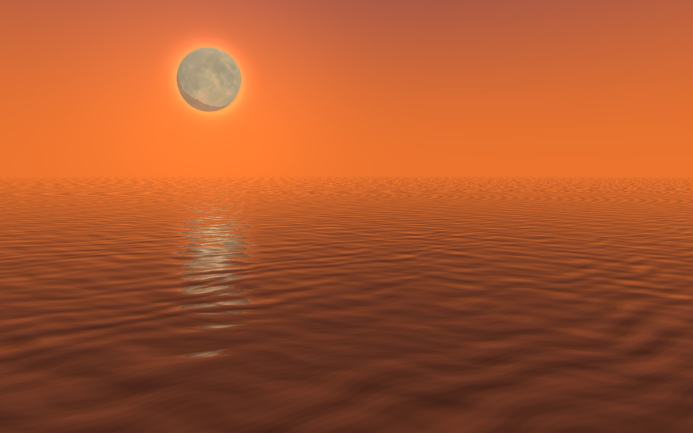

# Fly Me to the Moon

Attempt at capturing the end of NEON GENESIS EVANGELION in threejs.

**Live:** [mpts.ie/games/flymetothemoon](https://mpts.ie/games/flymetothemoon/)


## Skies

| Day | Sunset | Night |
|---|---|---|
|  |  |  |

| Midnight | Eclipse |
|---|---|
|  |  |

## Views

| Below | Below, by day |
|---|---|
|  |  |

| Cut | Above | Wide |
|---|---|---|
|  |  |  |

## Controls

Press **P** to show the sliders and **H** to hide all the controls. Tap the water to drop a ripple, drag the moon to spin it.

 

Every control can also be set in the address, for example `?sky=sunset&view=below&murk=0`.

## Running it

```bash
npm install
npm run dev      # local dev server
```

`python tools/make_textures.py` rebuilds the moon textures from NASA's CGI Moon Kit (needs numpy and pillow).

## Credits

Moon imagery and elevation: NASA's Scientific Visualization Studio, [CGI Moon Kit](https://svs.gsfc.nasa.gov/4720), public domain.

## License

The code is [MIT](LICENSE). The moon textures are NASA imagery and stay public domain.
